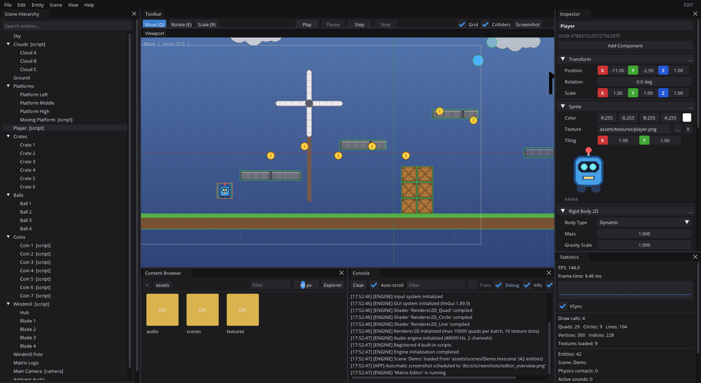
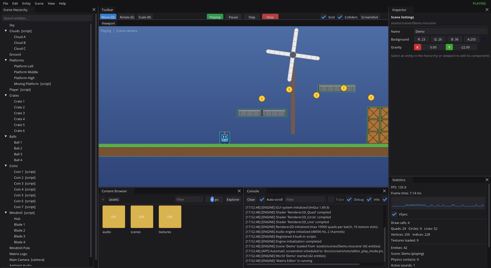
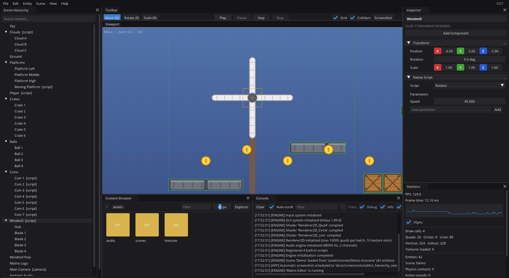
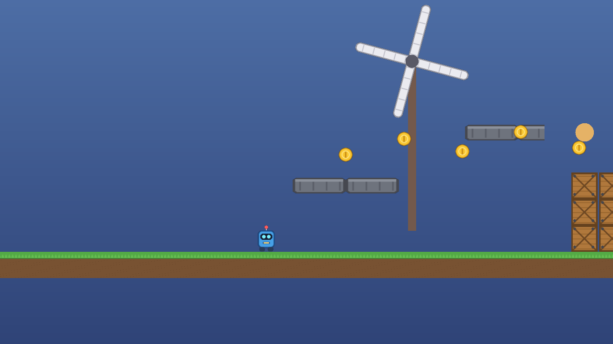

<p align="center">
  
</p>

<h1 align="center">Matrix Engine</h1>

<p align="center">
  An open-source 2D game engine with a visual editor, written in modern C++ on top of OpenGL.
</p>

<p align="center">
  
  
  
  
  
</p>

---

Matrix Engine started as a personal learning project and has grown into a small but complete 2D engine: an entity-component
scene model with hierarchy, a batched sprite renderer, built-in 2D physics, audio, C++ scripting, JSON scene files and a
dockable editor with play-in-editor. Everything in this README is implemented and the screenshots are captured from the
running editor.

## Screenshots

**The editor** with the demo scene open. Scene hierarchy on the left, viewport with grid and collider overlays in the
centre, inspector and statistics on the right, content browser and console at the bottom.



**Play mode.** Pressing *Play* simulates a copy of the scene: scripts run, physics and audio start, and the viewport
switches to the scene camera. *Stop* restores the edited scene untouched.



**Hierarchy and selection.** The windmill is a parent entity running the `Rotator` script; its hub and four blades are
child entities, so they inherit its rotation. The selected entity is outlined in the viewport and edited in the inspector.



**Standalone runtime.** The `Sandbox` application loads the same scene file without the editor, the way a shipped game would.



## Features

### Engine core
- Application / engine lifecycle with clean start-up and shutdown, frame timer, delta time and FPS tracking.
- Logging via spdlog to the console, a log file and an in-memory history shown in the editor console.
- Project-root aware file system (assets are referenced by root-relative paths, so scenes are portable).
- Named event bus, 64-bit UUIDs, assertion and verification macros.
- Keyboard and mouse input with per-frame pressed/released edges, scroll and mouse deltas.

### Rendering (OpenGL 4.5 core)
- Batched 2D renderer: up to 10,000 quads per draw call with 16 texture slots, plus anti-aliased circles and lines.
- Textures (PNG, JPG, BMP, TGA) with a cache, a white fallback texture and a magenta "missing texture" placeholder.
- Framebuffers with colour, integer entity-id (for mouse picking) and depth attachments.
- Orthographic cameras: scene cameras stored in components and a mouse/keyboard driven editor camera.
- Shader programs with uniform caching and hot reload from the editor.

### Scenes and entities
- Entity-component scenes built on EnTT: Tag, Transform, Sprite, Circle Renderer, Camera, Rigid Body 2D,
  Box/Circle Collider 2D, Native Script, Audio Source.
- Parent/child hierarchy with world-space transforms, re-parenting that preserves world position, duplication of subtrees.
- Scene copy for play mode and JSON serialization to human readable `.mxscene` files.
- Runtime lifecycle: start, update, pause, single-step, stop.

### Physics 2D (built in, no external dependency)
- Static, dynamic and kinematic bodies with gravity, mass, restitution, friction and damping.
- Axis-aligned box and circle colliders, trigger volumes, fixed-timestep simulation with sub-steps.
- Collision callbacks delivered to scripts, grounded detection for platformer movement.

### Scripting
- C++ scripts derive from `ScriptableEntity` and are registered by name, so scenes can reference them.
- Float parameters are edited in the inspector and saved with the scene.
- Built-in scripts: `Rotator`, `Oscillator`, `PlatformerController2D`, `CameraFollow2D`.

### Audio
- miniaudio based playback of WAV, MP3 and FLAC with volume, pitch and looping.
- Audio Source components that play on scene start; one-shot playback from scripts.

### Editor
- Dockable layout (Dear ImGui): Scene Hierarchy, Viewport, Inspector, Content Browser, Console, Statistics, Toolbar.
- Mouse picking through an entity-id attachment, selection outline, move / rotate / scale by dragging with snapping.
- Drag and drop: re-parent entities in the hierarchy, drop textures into the viewport to create sprites, drop assets onto
  component fields, double-click a scene file to open it.
- Play / pause / step / stop with scene snapshots, collider and camera-frustum overlays, grid, native file dialogs.
- Scene settings (name, background colour, gravity), statistics panel, screenshot capture (F12).

### Tooling
- Premake based build with a one-command bootstrap script, Debug and Release configurations.
- A test runner with 45 automated tests covering the core, world, physics, cameras and serialization (no GPU needed).
- Command-line options for reproducible screenshots and smoke tests (`--scene`, `--play`, `--screenshot`, `--camera`, `--select`).

## Technology stack

| Area | Library | Version |
|------|---------|---------|
| Windowing / input | [GLFW](https://www.glfw.org/) | 3.3.8 (prebuilt, in repo) |
| OpenGL loader | [GLEW](http://glew.sourceforge.net/) | 2.3 (prebuilt, in repo) |
| Math | [GLM](https://github.com/g-truc/glm) | 0.9.9.8 |
| Entity component system | [EnTT](https://github.com/skypjack/entt) | 3.12.2 |
| GUI | [Dear ImGui](https://github.com/ocornut/imgui) (docking branch) | 1.89.9 |
| Logging | [spdlog](https://github.com/gabime/spdlog) | 1.15.3 |
| Images | [stb_image / stb_image_write](https://github.com/nothings/stb) | master |
| Scene files | [nlohmann/json](https://github.com/nlohmann/json) | 3.11.3 (single header, in repo) |
| Audio | [miniaudio](https://miniaud.io/) | 0.11.21 (single header, in repo) |
| Build | [Premake](https://premake.github.io/) | 5.0.0 (binary in `vendor/premake`) |

The engine itself is C++20 and builds as a DLL (`Matrix.dll`); the editor, the sandbox and the tests link against it.

## Supported platforms

- **Windows 10/11, 64-bit** with a GPU driver that supports OpenGL 4.5 (any Intel, AMD or NVIDIA GPU from the last decade).
- **Visual Studio 2022 or 2026** with the "Desktop development with C++" workload. Premake generates the solution for
  whichever version is installed.

Other platforms are not supported yet; the window, file dialog and audio back-ends are Windows specific.

## Building

### 1. Clone with submodules

```bat
git clone --recursive https://github.com/JawherBenjeddou/Matrix-Engine.git
cd Matrix-Engine
```

If you cloned without `--recursive`, the bootstrap script below fetches the submodules for you.

### 2. Bootstrap and build

```bat
build.bat            :: fetches dependencies, generates the solution and builds Debug
build.bat Release    :: same, but builds the Release configuration
```

`build.bat` runs `python scripts/setup.py --build` (Python 3.8+ is required for the script only). It detects the newest
Visual Studio, downloads Premake if it is missing, generates `Matrix.slnx` (VS 2026) or `Matrix.sln` (VS 2022) and
invokes MSBuild. To only generate the project files run `GenerateProjects.bat`, then open the solution in Visual Studio.

Binaries land in `build/bin/<Configuration>/`:

| Executable | Purpose |
|------------|---------|
| `MatrixEditor.exe` | The editor. Opens `assets/scenes/Demo.mxscene` by default. |
| `Sandbox.exe` | Runs a scene without the editor. |
| `Tests.exe` | Automated tests; returns the number of failures as exit code. |

Executables locate the project root automatically (they look for the `resources/` folder next to or above the
executable and the working directory), so they can be started from Visual Studio, Explorer or a terminal.

### 3. Run the tests

```bat
build\bin\Debug\Tests.exe
```

## Using the engine

### The editor

- `File > Open Scene` loads a `.mxscene`; `File > Save` writes it back. New scenes are created with `Ctrl+N`.
- Create entities from the `Entity` menu or by right-clicking in the Scene Hierarchy. Presets exist for sprites, circles,
  cameras, physics boxes/circles and static platforms.
- Select an entity by clicking it in the viewport or in the hierarchy, then edit its components in the Inspector.
  `Add Component` lists the components the entity does not have yet; the `...` button on a component removes it.
- Drag textures from the Content Browser into the viewport to create sprites, or onto a Sprite's texture field.
- Press `Play` to simulate the scene; `Pause`/`Step` advance it one frame at a time; `Stop` returns to the edited scene.
- With nothing selected the Inspector shows the scene settings (name, background colour, gravity).

### Controls and shortcuts

| Input | Action |
|-------|--------|
| Left click | Select entity, drag to move / rotate / scale with the active tool |
| Middle or right drag, `Alt`+left drag | Pan the editor camera |
| Mouse wheel | Zoom towards the cursor |
| `W A S D` / arrow keys | Pan the camera (`Shift` is faster) |
| `Q` / `E` / `R` | Move / Rotate / Scale tool |
| `Ctrl` while dragging | Snap position to 0.5 units or rotation to 15 degrees |
| `F` | Focus the selected entity, `Home` resets the camera |
| `Ctrl+N` / `Ctrl+O` / `Ctrl+S` / `Ctrl+Shift+S` | New / open / save / save as |
| `Ctrl+D` / `Delete` | Duplicate / delete the selection |
| `Ctrl+P` | Play / stop |
| `F12` | Save a screenshot to `screenshots/` |
| `Escape` | Clear the selection |

In play mode the demo player uses `A`/`D` or the arrow keys to move and `Space` to jump. In the Sandbox, `R` reloads the
scene and `Escape` quits.

### Command-line options

Both the editor and the sandbox accept:

```
--scene <path>            scene to open (default assets/scenes/Demo.mxscene)
--screenshot <path>       save a screenshot after --frames frames and exit
--frames <n>              frames to wait before the screenshot (default 60 / 90)
```

The editor additionally understands `--play` (start in play mode), `--camera x,y,zoom`, `--select <entity name>`,
`--windowed` and `--viewports` (ImGui multi-viewport mode).

### Writing a game on the engine

Applications derive from `Matrix::core::Application` and override a handful of hooks:

```cpp
#include "Matrix.h"

class MyGame : public Matrix::core::Application
{
protected:
    bool OnStart() override
    {
        m_World = Matrix::CreateShared<Matrix::graphics::World>();
        Matrix::graphics::WorldSerializer(m_World).Deserialize("assets/scenes/Demo.mxscene");
        m_World->OnViewportResize(GetWindow().GetWidth(), GetWindow().GetHeight());
        m_World->OnRuntimeStart();
        return true;
    }

    void OnUpdate(float deltaTime) override
    {
        m_World->OnUpdateRuntime(deltaTime);   // scripts + physics
        m_World->OnRenderRuntime();            // draws through the primary camera
    }

    void OnShutdown() override { m_World->OnRuntimeStop(); }

private:
    Matrix::SharedObj<Matrix::graphics::World> m_World;
};

IMPLEMENT_APPLICATION_CLASS(MyGame)
#include "core/EntryPoint.h"
```

`Sandbox/src/SandboxApp.cpp` is a complete, slightly longer version of this.

### Writing a script

```cpp
#include "Matrix.h"
using namespace Matrix::graphics;

class Bouncer : public ScriptableEntity
{
protected:
    void OnUpdate(float deltaTime) override
    {
        auto& transform = GetComponent<TransformComponent>();
        transform.Position.y += std::sin(m_Time += deltaTime) * GetParameter("Amplitude", 1.0f) * deltaTime;
    }
    void OnCollision(const Collision2D& collision) override
    {
        MX_INFO("{} touched {}", GetEntity().GetName(), collision.Other.GetName());
    }
private:
    float m_Time = 0.0f;
};

// Once at start-up, before scenes are loaded:
MX_REGISTER_SCRIPT(Bouncer, { "Amplitude", 1.0f });
```

Add a *Native Script* component in the editor, pick `Bouncer` from the list, and its parameters appear in the Inspector.

### Scene files

Scenes are JSON. Entities are listed with their UUID, name and one object per component; parent/child links are stored
by UUID so files can be edited by hand or generated (see `scripts/generate_demo_scene.py`). Asset paths are relative to the
project root.

```json
{
  "Scene": "Demo",
  "Version": 1,
  "Gravity": [0.0, -22.0],
  "Entities": [
    {
      "ID": 7360604844160383805,
      "Tag": "Windmill",
      "TransformComponent": { "Position": [-5.5, 3.2, -1.0], "Rotation": 0.0, "Scale": [1, 1, 1] },
      "NativeScriptComponent": { "ScriptName": "Rotator", "Parameters": { "Speed": 45.0 } },
      "RelationshipComponent": { "Parent": 0, "Children": [ 1234, 5678 ] }
    }
  ]
}
```

## Example scene

`assets/scenes/Demo.mxscene` is a small platformer playground that exercises every system:

- a keyboard-controlled robot (`PlatformerController2D`) with a jump sound,
- static platforms, a platform animated with `Oscillator`, stacked physics crates and bouncing circle bodies,
- coins and clouds grouped under parent entities, a rotating windmill built from child entities,
- a primary camera running `CameraFollow2D` and a looping ambient audio source.

The sample art and sounds are procedurally generated by `scripts/generate_sample_assets.py` so the repository contains
no third-party content; re-run the script (needs Pillow) to tweak them.

## Project layout

```
MatrixEngine/   engine library (Matrix.dll)
  src/mx/core       application, engine core, logging, events, UUID
  src/mx/graphics   renderer, buffers, shaders, textures, cameras, world/ECS, serialization
  src/mx/physics    2D physics
  src/mx/audio      audio engine
  src/mx/scripting  built-in scripts
  src/mx/gui        Dear ImGui integration
  src/mx/ui         window and input
  src/mx/util       timer, file system, platform helpers
Editor/         the editor application and its panels
Sandbox/        standalone runtime example
Tests/          automated tests
assets/         scenes, textures and audio used by the demo
resources/      shaders, fonts and branding used by the engine
Dependencies/   third-party libraries (submodules + prebuilt GLFW/GLEW)
scripts/        setup / asset generation scripts
docs/           screenshots and architecture notes
```

See [docs/ARCHITECTURE.md](docs/ARCHITECTURE.md) for a tour of the main systems.

## Known limitations

- Windows only. The platform layer (window, dialogs, audio back-ends) would need porting for Linux or macOS.
- The physics system is intentionally simple: colliders are axis aligned (rotation is ignored), there is no rotational
  dynamics, no joints and no continuous collision detection, so very fast bodies can tunnel through thin geometry.
- Scripts are C++ only and must be compiled into the engine or the application; there is no hot reloading.
- No text rendering, sprite sheets/animation, particles, tilemaps or post-processing yet.
- Undo/redo is not implemented in the editor.
- The editor stores its layout in `build/editor_layout.ini`; use `View > Reset Layout` if panels get lost.

## Roadmap

- Sprite sheets, sprite animation component and a tilemap editor.
- Text rendering (bitmap/SDF fonts) and a simple UI layer for games.
- Undo/redo and multi-selection in the editor, prefab support.
- Rotated box colliders, joints and raycast queries in the physics system.
- Hot-reloadable scripting (C++ DLL modules or a scripting language such as Lua).
- Particle system and 2D lighting.
- Linux support (GLFW already abstracts most of the platform; dialogs and audio back-ends need alternatives).

## Contributing

Issues and pull requests are welcome. Please keep changes building without warnings in both configurations and run
`Tests.exe` before opening a pull request. See [CHANGELOG.md](CHANGELOG.md) for the history of the project.

## License

Matrix Engine is released under the [Apache License 2.0](LICENSE). Third-party libraries keep their own licenses, which
are included in their respective folders under `Dependencies/`.
